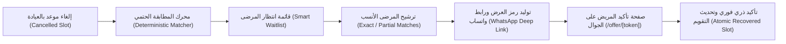

# 🦷 SlotCare — Smart Appointment Recovery & Waitlist SaaS
### منصة استرجاع المواعيد الطبية وقوائم الانتظار الذكية لعيادات الأسنان والمراكز الطبية

[](https://nextjs.org/)
[](https://www.typescriptlang.org/)
[](https://tailwindcss.com/)
[](https://supabase.com/)
[](https://github.com)

---

## 🌟 نظرة عامة (Overview)

**SlotCare** هو نظام سحابي متخصص (B2B SaaS) يعالج معضلة هدر المواعيد الناتجة عن الإلغاءات المتأخرة وتخلف المرضى عن الحضور في العيادات الطبية ومراكز طب الأسنان.

عند حدوث أي إلغاء مفاجئ لأي موعد، يُلغي النظام الاتصالات الهاتفية العشوائية من خلال:
1. **محرك مطابقة حتمي وفوري (Deterministic Matching Engine):** يطابق الموعد الشاغر فوراً مع المرضى الأنسب في قائمة الانتظار بناءً على نوع الخدمة، الطبيب المطلوب، والنافذة الزمنية وتفضيل "أي موعد اليوم".
2. **رابط حجز آمن ومشفر للاستخدام لمرة واحدة (One-Time Token):** توليد رمز مؤقت وخاص بالمريض.
3. **إرسال بنقرة واحدة عبر واتساب (1-Click WhatsApp Deep Link):** رسالة منسقة تلقائياً تُرسل للمريض عبر `https://wa.me/...`.
4. **تأكيد ذري وتحديث فوري لتقويم العيادة (Atomic Slot Claiming):** عند فتح المريض للرابط وتأكيده عبر هاتفه، يُحجز الموعد فوراً ويُبطل الرابط لمنع أي تعارض، وتُحدث شاشات العيادة في الوقت الحقيقي.

---

## 🏗️ المعمارية التقنية ومخطط سير العمل (Workflow Architecture)



---

## 🚀 الميزات الأساسية المنجزة (MVP Features)

- 📊 **لوحة التحكم والمؤشرات التراكمية (`/dashboard`):** 5 بطاقات لمؤشرات الأداء (المواعيد الملغاة، المواعيد المسترجعة، نسبة الاسترجاع %، متوسط وقت التعويض بالدقائق، والإيرادات المحمية).
- 📅 **تقويم العيادة متعدد الأطباء (`/calendar`):** جدول مواعيد لـ 4 أطباء أسنان مع فلاتر ذكية وإمكانية إلغاء الموعد واسترجاعه بنقرة واحدة.
- 👥 **قائمة الانتظار الذكية (`/waitlist`):** تسجيل المرضى مع تفضيلات الأيام، الأوقات، الطبيب المفضل، وتفعيل خيار الطوارئ "أي موعد اليوم".
- ⚡ **مركز تعويض المواعيد الشاغرة (`/open-slots`):** شاشة تفاعلية تشغل محرك المطابقة فور اختيار أي موعد شاغر، وتصنف المرشحين إلى:
  - **مطابق تماماً (`Exact Match`):** شارة خضراء بنسبة توافق 100%.
  - **مطابقة جزئية (`Partial Match`):** شارة كهرمانية/صفراء مع توضيح أسباب الترشيح.
  - زر توليد رابط واتساب الفوري ورابط الاختبار المحلي.
- 📜 **سجل تدقيق الاسترجاع (`/recovery-history`):** تتبع تفصيلي لكل عملية استرجاع (المريض الأصلي، المريض البديل، سرعة الاسترجاع، والإيراد المحمي).
- ⚙️ **إعدادات العيادة (`/settings`):** إدارة بيانات المركز الطبي، كادر الأطباء، والخدمات والمدد والأسعار.
- 📱 **صفحة المريض المستقلة للجوال (`/offer/[token]`):** واجهة ويب خفيفة وسريعة لا تتطلب تسجيل دخول، وتدعم تأكيد أو الاعتذار عن الموعد مع منع تكرار استخدام الرابط.
- 🔐 **بوابة تسجيل دخول الاستقبال (`/login`):** واجهة مصادقة الطاقم الطبي مهيأة للربط المباشر.

---

## 🗄️ مخطط قاعدة البيانات (Supabase / PostgreSQL Ready)

يتضمن المشروع ملف التهجير الجاهز في [`supabase/migrations/0001_initial_schema.sql`](./supabase/migrations/0001_initial_schema.sql) شاملاً:
1. `clinics`: بيانات المركز الطبي والمناطق الزمنية.
2. `staff`: حسابات وصلاحيات الطاقم الطبي (`admin` / `receptionist`).
3. `doctors`: بيانات الأطباء والتخصصات وأكواد الألوان للتقويم.
4. `services`: الخدمات والمدد بالدقائق والأسعار.
5. `appointments`: المواعيد وتتبع حالات الإلغاء والاسترجاع.
6. `waitlist`: قائمة الانتظار وتفضيلات الأيام والأوقات.
7. `slot_offers`: رموز عروض واتساب الآمنة وتواريخ الانتهاء.
8. **دالة `claim_slot_offer(offer_token)`:** دالة SQL ذرية تضمن خلو الحجز من ظاهرة الـ Race Conditions وقفل الصفوف بـ `FOR UPDATE`.

---

## 💻 التشغيل المحلي والتثبيت (Getting Started)

### المتطلبات المسبقة:
- Node.js (الإصدار 18 أو أحدث)
- npm أو pnpm أو yarn

### خطوات التشغيل:
```bash
# 1. استنساخ المستودع
git clone https://github.com/abod6911/slotcare.git
cd slotcare

# 2. تثبيت الحزم البرمجية
npm install

# 3. تشغيل خادم التطوير المحلي
npm run dev
```

افتح المتصفح على:
```
http://localhost:3000
```

---

## 🧪 سيناريو الاختبار التوضيحي السريع (1-Minute Interactive Demo)

1. ادخل إلى صفحة **مركز التعويض**: `http://localhost:3000/open-slots`
2. اختر الموعد الشاغر: **"الساعة 4:00 مساءً · تنظيف وتلميع الأسنان مع د. أحمد المنصور"**.
3. ستلاحظ مباشرة عمل محرك المطابقة وعرض المريض **عبدالعزيز التميمي** كـ **"مطابق تماماً (Exact Match)"**.
4. اضغط على زر **"إرسال عرض عبر WhatsApp"**، ثم اضغط **"فتح صفحة المريض"**.
5. ستفتح صفحة المريض للجوال: اضغط على **"تأكيد وحجز الموعد الآن"**.
6. عُد إلى **لوحة التحكم (`/dashboard`)** و **التقويم (`/calendar`)**: ستجد أن الموعد قد تم حجزه واسترجاعه فورياً وارتفعت مؤشرات العيادة بنجاح!

---

## 📄 الترخيص (License)
هذا المشروع مرخص بموجب رخصة [MIT License](./LICENSE).
