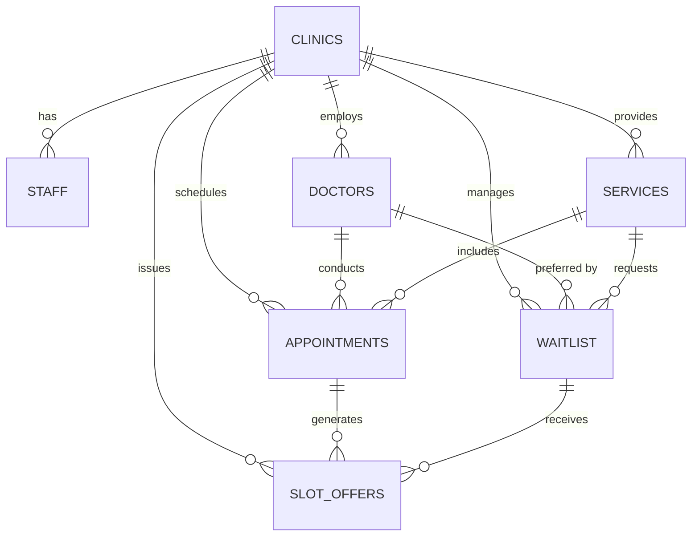
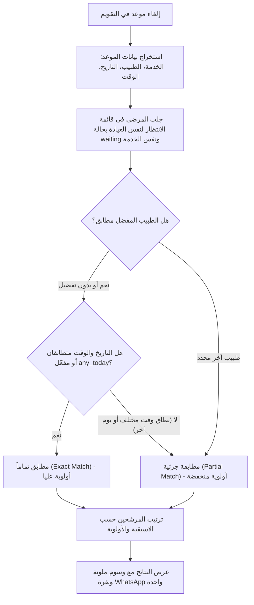

# وثيقة متطلبات المنتج والهندسة البرمجية — SlotCare MVP v1.0
## Product Requirements Document (PRD) & Technical Architecture

---

## 1. نظرة عامة ورؤية المنتج (Executive Summary & Core Value Proposition)
**SlotCare** هي منصة برمجية موجهة للعيادات الطبية ومراكز طب الأسنان (B2B SaaS) تهدف إلى حل مشكلة هدر المواعيد الناتجة عن الإلغاءات المفاجئة (No-shows & Late Cancellations).

### القيمة الجوهرية (Core Value Proposition)
عند إلغاء أي موعد داخل العيادة، تقوم المنصة فوراً بإلغاء الحاجة للاتصالات الهاتفية اليدوية المرهقة ("Phone-Tag") عن طريق:
1. **المطابقة الفورية والحتمية (Deterministic Matching Engine):** مطابقة الموعد الشاغر تلقائياً مع المرضى المسجلين في قائمة الانتظار الذكية حسب الخدمة والوقت والطبيب المفضل.
2. **رابط تأكيد آمن للاستخدام لمرة واحدة (One-Time Secure Confirmation Link):** توليد رمز مشفر مؤقت ومخصص للمريض.
3. **إرسال العرض بنقرة واحدة عبر واتساب (1-Click WhatsApp Deep Link):** تمكين موظف الاستقبال من فتح محادثة WhatsApp مباشرة مع المريض برسالة منسقة ورابط فوري.
4. **تأكيد ذري فوري وتحديث التقويم (Atomic Real-time Booking):** عندما يضغط المريض على رابط الويب عبر هاتفه لتأكيد الموعد، يتم حجز الموعد ذرياً (Atomically) وإبطال الرابط لمنع التعارض وتحديث تقويم العيادة فوراً.

---

## 2. حدود نطاق الإصدار الأول (Strict MVP Scope Boundaries)
يتضمن الإصدار الأول (MVP v1.0) الميزات الثماني الأساسية حصراً:

| # | الميزة الأساسية | التفاصيل والهدف |
|---|---|---|
| **1** | **مصادقة موظفي العيادة (Staff Auth)** | تسجيل دخول آمن لموظفي الاستقبال والإدارة عبر البريد الإلكتروني وكلمة المرور. |
| **2** | **إعداد الأطباء والخدمات** | إدخال بيانات الأطباء (التخصص، اللون التعريفي) والخدمات (المدة بالدقائق، السعر). |
| **3** | **إدارة المواعيد (Appointments CRUD)** | إنشاء وتعديل وإلغاء المواعيد، مع تتبع حالة الموعد وتوقيت الإلغاء. |
| **4** | **قائمة الانتظار الذكية (Smart Waitlist)** | تسجيل المريض مع تفضيلات الأيام، النطاق الزمني المفضل، الطبيب المفضل، وإمكانية قبول "أي موعد اليوم". |
| **5** | **محرك مطابقة المواعيد الحتمي (Deterministic Matcher)** | خوارزمية ذكية تصنف المرشحين إلى: مطابق تماماً (Exact Match)، أو مطابق جزئياً (Partial Match). |
| **6** | **توليد عروض WhatsApp وروابط الحجز** | إنشاء رمز عرض آمن ورابط واتساب مباشر بصيغة `https://wa.me/...` ورابط ويب مستقل `/offer/[token]`. |
| **7** | **تحديث ذري للحجز (Atomic Slot Claiming)** | دالة قاعدة بيانات تضمن عدم حجز الموعد مرتين وإبطال العرض فور قبوله. |
| **8** | **لوحة تحليلات الاسترجاع (Recovery Analytics)** | قياس مؤشرات الأداء: المواعيد الملغاة، المسترجعة، نسبة الاسترجاع %، ومتوسط وقت التعويض. |

---

## 3. الاستثناءات الصريحة (Explicit Exclusions - Non-Goals in v1.0)
حرصاً على سرعة الإطلاق والتركيز الفائق، يُمنع بناء التالي في v1.0:
- **لا يوجد تطبيق أصيل (Native App) للمرضى أو تسجيل دخول للمريض:** التأكيد يتم عبر رابط ويب خفيف متجاوب مع الهواتف دون الحاجة لكلمة مرور أو تثبيت تطبيق.
- **لا يوجد ملفات وسجلات طبية (EMR / EHR):** لا يتم تخزين تشخيصات طبية أو تاريخ مرضي تفصيلي.
- **لا توجد إدارة تأمين طبي (Insurance Management).**
- **لا تستخدم نماذج الذكاء الاصطناعي التوليدي (No LLMs / AI Agents) في المطابقة:** تعتمد المطابقة على منطق برمجي حتمي وخوارزميات محددة لضمان الدقة والسرعة الموثوقة.
- **لا توجد هياكل مستشفيات معقدة متعددة الفروع (No Multi-hospital Enterprise Hierarchy):** التركيز على عيادة واحدة متعددة الأطباء أولاً، مع عزل البيانات بواسطة `clinic_id` في قاعدة البيانات للتوسع المستقبلي.
- **لا توجد رسائل واتساب جماعية مؤتمتة (No Automated Bulk WhatsApp Spam):** الإرسال يتم يدوياً بنقرة واحدة من موظف الاستقبال لتجنب حظر الأرقام وتوفير تكاليف WhatsApp Business API في مرحلة الانطلاق.
- **لا يوجد تكاملات خارجية مع أنظمة إدارة العيادات القديمة (No External Third-Party PMS Integrations).**

---

## 4. تصميم قاعدة البيانات (Database Schema & Relational Integrity)
قاعدة البيانات مبنية على **PostgreSQL** عبر **Supabase** مع تفعيل تقنية **Row Level Security (RLS)** لضمان عزل بيانات كل عيادة عبر `clinic_id`.

### الجداول الأساسية السبعة:

#### 1. جدول العيادات (`clinics`)
- `id` (UUID, Primary Key)
- `name` (TEXT): اسم العيادة (مثال: عيادة سمايل لطب الأسنان)
- `phone` (TEXT): رقم هاتف العيادة
- `timezone` (TEXT): المنطقة الزمنية (الافتراضي: `Asia/Riyadh`)
- `created_at` (TIMESTAMPTZ)

#### 2. جدول الموظفين (`staff`)
- `id` (UUID, Primary Key)
- `clinic_id` (UUID, Foreign Key -> `clinics.id`)
- `user_id` (UUID, Foreign Key -> `auth.users.id`)
- `full_name` (TEXT)
- `role` (TEXT): (`admin` أو `receptionist`)
- `created_at` (TIMESTAMPTZ)

#### 3. جدول الأطباء (`doctors`)
- `id` (UUID, Primary Key)
- `clinic_id` (UUID, Foreign Key -> `clinics.id`)
- `full_name` (TEXT): اسم الطبيب (مثال: د. أحمد المنصور)
- `specialty` (TEXT): التخصص (مثال: جراحة الفم والأسنان)
- `color_code` (TEXT): لون تمييز الطبيب في التقويم (HEX Code)
- `is_active` (BOOLEAN): الحالة
- `created_at` (TIMESTAMPTZ)

#### 4. جدول الخدمات (`services`)
- `id` (UUID, Primary Key)
- `clinic_id` (UUID, Foreign Key -> `clinics.id`)
- `name` (TEXT): اسم الخدمة (مثال: تنظيف وتلميع الأسنان)
- `duration_minutes` (INTEGER): مدة الموعد بالدقائق (30, 45, 60...)
- `price` (DECIMAL): السعر بالريال/العملة المحلية
- `is_active` (BOOLEAN)
- `created_at` (TIMESTAMPTZ)

#### 5. جدول المواعيد (`appointments`)
- `id` (UUID, Primary Key)
- `clinic_id` (UUID, Foreign Key -> `clinics.id`)
- `doctor_id` (UUID, Foreign Key -> `doctors.id`)
- `service_id` (UUID, Foreign Key -> `services.id`)
- `patient_name` (TEXT)
- `patient_phone` (TEXT)
- `start_time` (TIMESTAMPTZ)
- `end_time` (TIMESTAMPTZ)
- `status` (TEXT): (`scheduled`, `cancelled`, `recovered`, `completed`, `no_show`)
- `cancelled_at` (TIMESTAMPTZ, Nullable)
- `recovered_from_appointment_id` (UUID, Nullable, Self-Reference)
- `created_at` (TIMESTAMPTZ)

#### 6. جدول قائمة الانتظار الذكية (`waitlist`)
- `id` (UUID, Primary Key)
- `clinic_id` (UUID, Foreign Key -> `clinics.id`)
- `patient_name` (TEXT)
- `patient_phone` (TEXT)
- `service_id` (UUID, Foreign Key -> `services.id`)
- `preferred_doctor_id` (UUID, Nullable, Foreign Key -> `doctors.id`)
- `preferred_days` (TEXT[] / JSONB): الأيام المفضلة (مثل `["Sunday", "Monday", "Today"]`)
- `preferred_time_start` (TIME)
- `preferred_time_end` (TIME)
- `any_today` (BOOLEAN): هل يقبل أي موعد متاح اليوم عند الإلغاء الفوري
- `status` (TEXT): (`waiting`, `offered`, `booked`, `archived`)
- `notes` (TEXT)
- `created_at` (TIMESTAMPTZ)

#### 7. جدول عروض المواعيد الشاغرة (`slot_offers`)
- `id` (UUID, Primary Key)
- `clinic_id` (UUID, Foreign Key -> `clinics.id`)
- `appointment_id` (UUID, Foreign Key -> `appointments.id`)
- `waitlist_id` (UUID, Foreign Key -> `waitlist.id`)
- `token` (TEXT, Unique Index): رمز التحقق الآمن (Secure Random Hash)
- `status` (TEXT): (`pending`, `accepted`, `declined`, `expired`)
- `sent_at` (TIMESTAMPTZ)
- `responded_at` (TIMESTAMPTZ, Nullable)
- `expires_at` (TIMESTAMPTZ)
- `created_at` (TIMESTAMPTZ)

---

## 5. خوارزمية محرك المطابقة الحتمي (Deterministic Slot Matcher)
تعمل الخوارزمية عند إلغاء موعد أو استعراض المواعيد الشاغرة وفق الترتيب الصارم التالي:

### معايير التصنيف:
1. **مطابق تماماً (Exact Match - شارة خضراء):**
   - نفس الخدمة المطلوبة.
   - الطبيب المفضل هو نفس طبيب الموعد الملغي، أو لم يحدد المريض طبيباً معيناً (أي طبيب مقبول).
   - إما أن المريض يطلب "أي موعد اليوم" (`any_today = true`) والموعد اليوم، أو أن يوم الموعد ووقت الموعد يقعان تماماً ضمن النطاق الزمني المفضل للمريض.
2. **مطابقة جزئية (Partial Match - شارة برتقالية/صفراء):**
   - نفس الخدمة المطلوبة.
   - لكن الطبيب يختلف، أو الوقت يختلف قليلاً عن النافذة المفضلة، أو اليوم يختلف مع استعداد المريض لتلقي عروض بديلة.

---

## 6. الأمان والعمليات الذرية (Atomic Slot Claiming & Race Condition Prevention)
تجنباً لظاهرة الـ Race Condition (إذا أُرسل العرض لأكثر من مريض أو فتح المريض الرابط متأخراً)، تُنفذ عملية الحجز عبر دالة SQL مخزنة (Stored Procedure / RPC) تضمن:
1. قفل صف الموعد وعرض الحجز (`SELECT ... FOR UPDATE`).
2. التحقق من أن رمز العرض لم ينتهِ تاريخه (`expires_at > NOW()`) وحالته `pending`.
3. التحقق من أن الموعد لا يزال متاحاً ولم يُحجز من قبل مريض آخر.
4. تحديث حالة العرض إلى `accepted` وتاريخ الاستجابة إلى `NOW()`.
5. تحديث الموعد إلى `recovered` وتسجيل اسم المريض الجديد ورقم هاتفه.
6. تحديث حالة المريض في قائمة الانتظار إلى `booked`.
7. إلغاء/إبطال أي عروض أخرى معلقة لنفس الموعد وتحويلها إلى `expired`.

---

## 7. هندسة واجهات المستخدم (RTL-First Clinical UX / UI Design System)
- **الاتجاه:** عربي أصيل من اليمين لليسار (`dir="rtl"` و `lang="ar"`).
- **الخطوط:** خطوط عربية حديثة واضحة ومقروءة ومريحة للعين الطبية (`IBM Plex Sans Arabic` أو `Cairo`) مع أرقام إنجليزية واضحة (`tabular-nums`) للساعات والنسب المالية.
- **نظام الألوان:** لوحة مستوحاة من العيادات الحديثة (Medical Slate / Indigo / Teal & Emerald for Success / Rose for Cancellations).
- **الشاشات الرئيسية:**
  1. `/dashboard`: لوحة التحكم والمؤشرات التراكمية.
  2. `/calendar`: تقويم المواعيد متعدد الأطباء وإلغاء المواعيد السريع.
  3. `/waitlist`: قائمة الانتظار الذكية وإضافة المرضى.
  4. `/open-slots`: مركز تعويض المواعيد الشاغرة ومحرك المطابقة الفوري.
  5. `/recovery-history`: سجل وتاريخ المواعيد المسترجعة.
  6. `/settings`: إعدادات العيادة، الأطباء، والخدمات.
  7. `/offer/[token]`: صفحة المريض المستقلة المتجاوبة مع الهواتف دون تسجيل دخول.
  8. `/login`: تسجيل دخول الطاقم الطبي.
